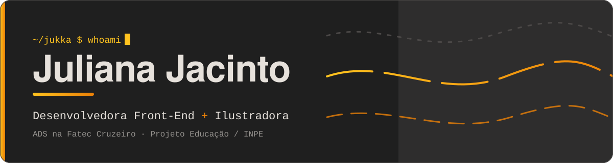
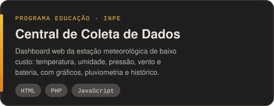
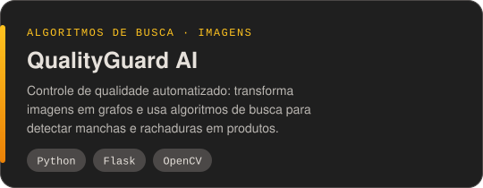
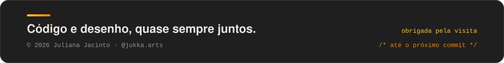

 

## ₊˚꩜ Sobre mim ✮˚₊

Sou graduada em **Análise e Desenvolvimento de Sistemas** pela Fatec Cruzeiro, com interesse em desenvolvimento de software, pesquisa tecnológica e criação de soluções que integrem diferentes áreas do conhecimento.

Ao longo da minha trajetória acadêmica e profissional, tive experiências com **_desenvolvimento web_**, **_construção de aplicações_**, **_implementação de algoritmos_** e **_projetos de inovação tecnológica_**.

Durante minha participação como bolsista no _**Instituto Nacional de Pesquisas Espaciais (INPE)**_, atuei no desenvolvimento de uma estação meteorológica de baixo custo. Minha contribuição envolveu o estudo, recuperação e calibração de um anemômetro, além do desenvolvimento de uma placa eletrônica e implementação de código para integração do sensor ao sistema de coleta de dados. ⋆｡☁︎｡⋆

Também participei de atividades de divulgação científica, eventos, exposições e oficinas de programação com Arduino.

Atualmente, continuo ampliando meus conhecimentos em desenvolvimento de software e Inteligência Artificial, por meio dos estudos em Engenharia de Agentes de IA.

## ₊˚꩜ Áreas de interesse ✮˚₊

- _Desenvolvimento de Software e Aplicações Web_
- _Pesquisa e Desenvolvimento Tecnológico_
- _Inteligência Artificial e Algoritmos_
- _Internet das Coisas (IoT)_
- _Experiência do Usuário e Interfaces Digitais_
- _Inovação e Projetos de Tecnologia_

## ₊˚꩜ Tecnologias e Ferramentas ✮˚₊

Com o que já trabalhei na prática, em projetos acadêmicos e profissionais.

### (•ᴥ•˶ᐡ)ഒ⁾⁾ Desenvolvimento Web 

  

  

### Programação e Back-end

  

  

### Sistemas Embarcados e IoT

  
  
  

### Banco de Dados e Ferramentas

  

  

 

## 🚀 Projetos

<table>
  <tr>
    <td width="50%" valign="top">
      
    </td>
    <td width="50%" valign="top">
      
    </td>
  </tr>
  <tr>
    <td width="50%" valign="top">
      
    </td>
    <td width="50%" valign="top">
      
    </td>
  </tr>
</table>

 

## Estatísticas do GitHub

  

  

 

