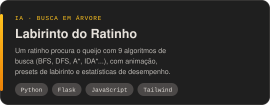
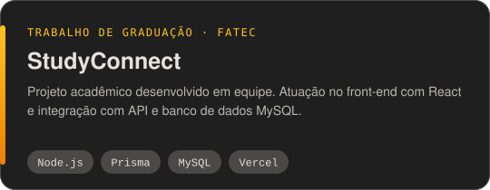

 
 

---

## ₊˚꩜ Sobre mim ✮˚₊

Sou graduada em **Análise e Desenvolvimento de Sistemas** pela Fatec Cruzeiro, com interesse em desenvolvimento de software, pesquisa tecnológica e criação de soluções que integrem diferentes áreas do conhecimento.

Ao longo da minha trajetória acadêmica e profissional, tive experiências com **desenvolvimento web**, **construção de aplicações**, **implementação de algoritmos** e **projetos de inovação tecnológica**.

Durante minha atuação como bolsista no **Instituto Nacional de Pesquisas Espaciais (INPE)**, participei do desenvolvimento de uma estação meteorológica de baixo custo. Minha contribuição esteve concentrada no estudo, recuperação e calibração de um anemômetro, incluindo o desenvolvimento de uma placa eletrônica e a implementação de código para viabilizar o funcionamento e a integração do sensor à estação.

Após sua adaptação, o sensor realizou coletas de dados que possibilitaram estudos e análises comparativas com uma estação meteorológica de referência. O desenvolvimento também envolveu atividades de divulgação científica, participação em eventos, exposições e oficinas de programação com Arduino.

Atualmente, continuo ampliando meus conhecimentos em desenvolvimento de software e Inteligência Artificial, por meio da formação em **Engenharia de Agentes de IA**, da Alura.

## ₊˚꩜ Áreas de interesse ✮˚₊

- Desenvolvimento de Software e Aplicações Web
- Pesquisa e Desenvolvimento Tecnológico
- Inteligência Artificial e Algoritmos
- Internet das Coisas (IoT)
- Experiência do Usuário e Interfaces Digitais
- Inovação e Projetos de Tecnologia

## ₊˚꩜ Tecnologias e Ferramentas ✮˚₊

Tecnologias e ferramentas com as quais tive contato em projetos acadêmicos e profissionais. Minha familiaridade varia conforme a tecnologia e o contexto de utilização.

### Desenvolvimento Web

  

### Programação e Back-end

  

Python: conhecimentos básicos, com aplicação em projetos acadêmicos.

### Sistemas Embarcados e IoT

  
  
  

### Banco de Dados e Versionamento

  

### CMS e Design de Interfaces

  

---

## ₊˚꩜ Projetos em destaque ✮˚₊

<table>
  <tr>
    <td width="50%" valign="top">
      
    </td>
    <td width="50%" valign="top">
      
    </td>
  </tr>
  <tr>
    <td width="50%" valign="top">
      
    </td>
    <td width="50%" valign="top">
      
    </td>
  </tr>
</table>

 

## ₊˚꩜ Estatísticas do GitHub} ✮˚₊

  

  

 

